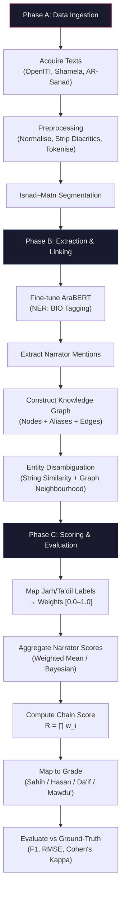
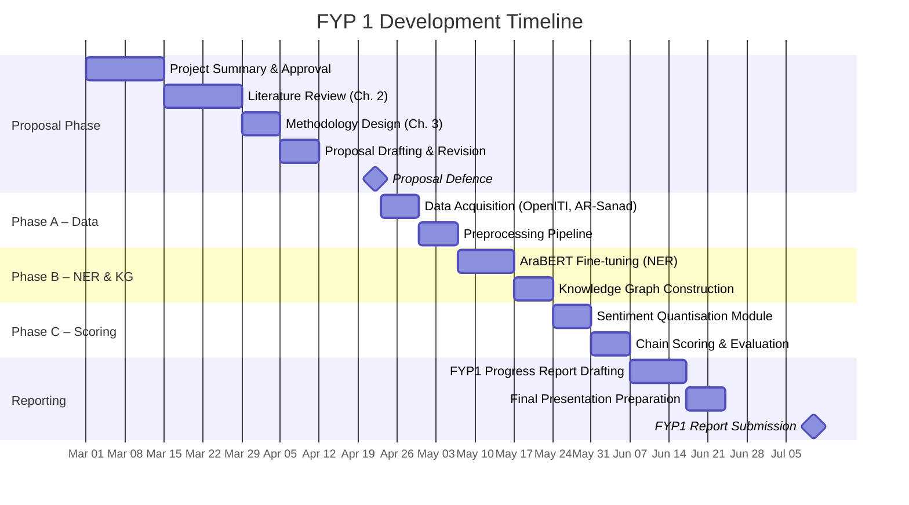

# Chapter 3: Project Methodology and Planning

## 3.1 Research Design

This project adopts an **experimental research design** underpinned by the Design Science Research Methodology (DSRM). The central artefact is an end-to-end automated pipeline that ingests classical Arabic biographical text, extracts and disambiguates narrator entities, and produces a continuous reliability score for each narrator — thereby operationalising the traditional science of *Jarh wa Ta'dīl* through computational means. Development proceeds through three sequential phases, each corresponding to a distinct research objective defined in Section 1.4. Each phase produces a testable intermediate output that feeds into the next, ensuring that failures can be isolated and addressed incrementally.

The methodology is structured as follows: **Phase A** establishes the data foundation; **Phase B** constructs the extraction and disambiguation engine; **Phase C** implements the scoring model and end-to-end evaluation. Together, these phases form the technical pipeline illustrated in Section 3.5.

## 3.2 Phase A — Data Ingestion and Preprocessing

### 3.2.1 Data Sources

The primary data sources are twofold:

1. **Biographical Texts**: Digitised editions of *Taqrīb al-Tahdhīb* (Ibn Hajar al-'Asqalānī) and *Tahdhīb al-Kamāl* (al-Mizzī), sourced from the OpenITI corpus and the Shamela Digital Library. These texts provide the *Jarh wa Ta'dīl* labels (qualitative scholarly assessments) that form the ground-truth input for the reliability scoring model.
2. **Benchmark Isnād Dataset**: The AR-Sanad 280K dataset, which contains approximately 280,000 synthetically augmented isnād chains with annotated narrator boundaries — used for training and evaluating the NER component.

### 3.2.2 Preprocessing Pipeline

Classical Arabic text presents unique preprocessing challenges due to its consonantal script, optional diacritical marks (*tashkīl*), and the absence of standardised punctuation in historical manuscripts. The preprocessing pipeline addresses these challenges through the following steps:

1. **Encoding Normalisation**: All source texts are converted to UTF-8, with Byte Order Marks (BOM) and legacy Windows-1256 artefacts stripped.
2. **Unicode Normalisation**: The Arabic text is normalised to NFKC form. Variant forms of Alif (أ, إ, آ) are collapsed to bare Alif (ا), and Ta Marbuta (ة) is normalised to Ha (ه) where contextually appropriate, using the CAMeL Tools normalisation utilities.
3. **Diacritic Stripping**: Optional *tashkīl* (short vowel marks) and *shadda* are removed to produce a consonantal skeleton, reducing orthographic variance without sacrificing semantic content.
4. **Tokenisation**: Sentences are tokenised using the Farasa segmenter, which handles Arabic clitics (conjunctions, prepositions, and definite articles prefixed to words) by splitting them into separate tokens. This step is critical for downstream NER, as narrator names frequently appear with attached particles (e.g., وعن → و + عن).
5. **Isnād–Matn Segmentation**: Each Hadith record is split into its isnād (chain) and matn (body) segments using transmission keyword detection. Transition markers such as *حدثنا* (narrated to us), *أخبرنا* (informed us), and *عن* (from) are used as boundary signals. Only the isnād portion is retained for downstream processing.

### 3.2.3 Expected Output

The output of Phase A is a cleaned, tokenised corpus of approximately 1,500 biographical entries and 1,000 segmented isnād chains, stored in a structured JSON format with the following schema per record: `{id, raw_text, normalised_text, tokens[], source_book, entry_type}`.

## 3.3 Phase B — Named Entity Recognition and Knowledge Graph Construction

### 3.3.1 NER Model Architecture

Narrator extraction is performed using a fine-tuned Transformer-based model. The base model is **AraBERT v2** (or **MARBERT** as a dialectal fallback), a pre-trained bidirectional encoder trained on a large Modern Standard Arabic corpus. The model is fine-tuned on the AR-Sanad 280K dataset for a token classification task using the BIO (Beginning, Inside, Outside) tagging scheme. The following entity types are annotated:

| Tag | Entity Type | Example |
|-----|-------------|---------|
| `B-NARRATOR` | Beginning of narrator name | محمد |
| `I-NARRATOR` | Inside narrator name | بن عبد الله |
| `B-KUNYA` | Patronymic honorific | أبو هريرة |
| `B-NISBA` | Geographic/tribal affiliation | البخاري |
| `O` | Outside any entity | حدثنا |

The model is trained for 10 epochs with a learning rate of 2e-5, using the AdamW optimiser with a linear warmup schedule over the first 10% of training steps. Evaluation is performed on a held-out 20% test split of the AR-Sanad dataset, with **micro-averaged F1-score** as the primary metric.

### 3.3.2 Knowledge Graph Construction

Extracted entity mentions are linked to canonical narrator identities stored in a **Knowledge Graph (KG)**. The KG is constructed using the Python `NetworkX` library (with optional migration to Neo4j for scalability) and is populated from the *Tahdhīb al-Kamāl* biographical entries. Each node in the KG represents a unique narrator and stores the following attributes:

- **Canonical Name** (الاسم الكامل)
- **Known Aliases** (الكنى والألقاب) — alternative names, kunya, and laqab
- **Birth/Death Dates** (where available)
- **Geographic Region** (nisba-derived)
- **Jarh wa Ta'dīl Labels** — the raw evaluative terms assigned by classical scholars

Edges represent **transmission relationships** (teacher → student) extracted from isnād chains. When the NER model produces a name mention, the KG is queried using a combination of string similarity (Levenshtein distance on the consonantal skeleton) and graph neighbourhood matching (shared teachers/students) to resolve the mention to its most probable canonical identity.

### 3.3.3 Expected Output

The output of Phase B is a populated Knowledge Graph containing approximately 1,500 canonical narrator nodes with linked aliases, biographical metadata, and transmission edges — alongside an NER model capable of extracting narrator mentions from unseen isnāds with a target F1-score of ≥ 0.90.

## 3.4 Phase C — Probabilistic Trust Scoring and Evaluation

### 3.4.1 Semantic Sentiment Quantisation

The core innovation of this phase is the translation of qualitative *Jarh wa Ta'dīl* labels into a continuous reliability score on the interval [0.0, 1.0]. This is achieved through **Semantic Sentiment Quantisation**, which proceeds in two steps:

1. **Term Mapping**: Each classical evaluative term is assigned a base weight according to the hierarchical grading scale established in the classical Hadith sciences. For example:

   | Term (Arabic) | Transliteration | Grade | Base Weight |
   |---------------|-----------------|-------|-------------|
   | ثقة ثقة | Thiqah Thiqah | Highest Ta'dīl | 1.00 |
   | ثقة | Thiqah | Strong Ta'dīl | 0.90 |
   | صدوق | Sadūq | Moderate Ta'dīl | 0.70 |
   | ليّن | Layyīn | Mild Jarh | 0.35 |
   | ضعيف | Da'īf | Moderate Jarh | 0.20 |
   | كذّاب | Kadhdhāb | Severe Jarh | 0.00 |

2. **Aggregation**: Where multiple scholars have assessed the same narrator using different terms, the individual weights are aggregated into a single composite score. Two aggregation strategies will be compared: (a) a **weighted arithmetic mean**, where the weight of each assessment is influenced by the historical prominence of the assessing scholar; and (b) a **Bayesian posterior estimation**, where each successive assessment updates a prior distribution over the narrator's reliability.

### 3.4.2 Chain-Level Scoring

Once each narrator in a given isnād has been assigned an individual reliability score *w_i*, the chain-level reliability *R* is computed as the product of individual scores:

**R(chain) = ∏ w_i** for all narrators *i* in the chain.

This multiplicative model reflects the classical principle that a chain is only as strong as its weakest link — a single severely criticised narrator drives the entire chain score toward zero. The chain-level score *R* is then mapped to the traditional grading categories (Sahih, Hasan, Da'if, Mawdu') using threshold boundaries calibrated against the ground-truth labels in the evaluation set.

### 3.4.3 Evaluation Protocol

The automated grades are evaluated against **ground-truth Hadith classifications** drawn from pre-graded collections in the *Al-Kutub al-Sittah* (the Six Canonical Books). The following metrics are reported:

| Metric | Purpose |
|--------|---------|
| **Accuracy** | Overall proportion of correctly classified Hadiths |
| **Precision / Recall / F1** | Per-class performance for each grading category |
| **RMSE** | Root Mean Squared Error between predicted chain scores and expected ordinal grades |
| **Cohen's Kappa** | Inter-rater agreement between automated and classical human grades |

A baseline comparison is conducted against a naive majority-class classifier and a simple lexical lookup model (direct term-to-grade mapping without graph features) to quantify the contribution of each pipeline component.

## 3.5 Flow Chart of Activities

## 3.6 Milestones and Dates

| Week | Milestone | Deliverable |
|------|-----------|-------------|
| 1–2 | Project Initialisation | Finalised project summary; supervisor approval |
| 3–4 | Literature Review | Completed Chapter 2; dataset acquisition |
| 5–6 | Methodology Design | Completed Chapter 3; proposal draft |
| 7 | **Proposal Defence** | Oral defence and proposal submission |
| 8–9 | Phase A Implementation | Cleaned corpus; preprocessed JSON dataset |
| 10–11 | Phase B Implementation | Trained NER model; populated Knowledge Graph |
| 12–13 | Phase C Implementation | Trust scoring module; preliminary evaluation results |
| 14 | **FYP1 Progress Report** | Written report and presentation |

## 3.7 Gantt Chart

## 3.8 Tools and Technologies

| Category | Tool / Library | Purpose |
|----------|---------------|---------|
| **Language** | Python 3.10+ | Primary development language |
| **NLP Preprocessing** | CAMeL Tools, PyArabic, Farasa | Arabic normalisation, tokenisation, segmentation |
| **Transformer Model** | AraBERT v2 / MARBERT (HuggingFace) | Fine-tuned NER for narrator extraction |
| **Deep Learning** | PyTorch, Transformers (HuggingFace) | Model training and inference |
| **Graph Processing** | NetworkX / Neo4j | Knowledge Graph construction and querying |
| **Evaluation** | scikit-learn | Classification metrics (F1, Precision, Recall, Kappa) |
| **Data Format** | JSON, CSV | Structured intermediate data storage |
| **Version Control** | Git / GitHub | Source code and experiment tracking |
| **Documentation** | Markdown, LaTeX | Proposal and report writing |
