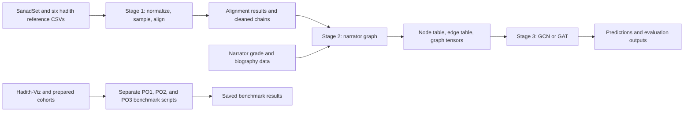

# Frozen v4 Implementation Walkthrough

This walkthrough follows the report-centered v4 bundle in this folder. It separates the staged prototype from the benchmark scripts used for the report. The root stage commands do not automatically run the full benchmark sequence.

## One-minute explanation

"The implementation has a data preparation stage, a graph construction stage, and a graph model stage. Stage 1 loads and normalizes hadith text, samples reference records, and matches them to SanadSet. Stage 2 converts matched narrator chains into a directed graph and attaches biographical fields. Stage 3 trains a GCN or GAT to predict narrator reliability classes. PO1, PO2, and the exploratory PO3 analysis are run by separate scripts. Their saved outputs are the evidence for the report results."

## Architecture

## Stage 1: data preparation and alignment

Start with [run_stage1.py](../run_stage1.py). The data paths and alignment settings are in [src/config.py](../src/config.py). The loader modules read the SanadSet CSV and six local reference CSVs. The preprocessing modules normalize Arabic text and parse narrator chains.

For the default 1,200 book-balanced setting, the sampler draws 300 reference hadiths per book before alignment. This is an oversample intended to yield 1,200 aligned records; it is not a guarantee of 1,200 accepted matches.

[hybrid_aligner.py](../src/alignment/hybrid_aligner.py) uses character TF-IDF to retrieve up to 10 candidate SanadSet records. The configured character n-gram range is 3 to 5, the vocabulary cap is 50,000, and candidate verification uses RapidFuzz partial ratio with a 95 threshold. A deterministic narrator-chain comparison is used to resolve matching-score ties.

The Stage 1 code writes suffixed names such as alignment_results_1200_book_balanced.json and kutub_sitta_evaluation_1200_book_balanced.csv. It writes sanadset_cleaned.csv only in sample or limited-row mode.

## Stage 2: narrator transmission graph

[run_stage2.py](../run_stage2.py) calls [src/stage2/pipeline.py](../src/stage2/pipeline.py). [graph_builder.py](../src/stage2/graph_builder.py) uses each accepted alignment's corpus index to retrieve a SanadSet row, parses the Sanad list, and adds directed edges between consecutive narrator entries. The implementation caps a chain at 30 entries and aggregates duplicate source-target-method edges into a frequency-weighted edge.

The builder calculates node appearances, in-degree, out-degree, and average chain position. It also attaches grade and biography fields from the narrator-grade input. [graph_exporter.py](../src/stage2/graph_exporter.py) makes these eight node input features:

| Feature | Implementation |
| --- | --- |
| total_appearances | Log-normalized number of chain appearances. |
| in_degree | Log-normalized incoming edge count. |
| out_degree | Log-normalized outgoing edge count. |
| net_flow | (out_degree - in_degree) / (out_degree + in_degree + 1). |
| avg_chain_position | Average position scaled by the maximum observed position. |
| has_death_info | Binary flag for a nonempty death-info field. |
| has_tabaqa | Binary flag for a nonempty generation field. |
| tabaqa_num | Parsed generation number normalized to the configured scale. |

The exporter stores labels and train, validation, and test masks separately from the eight input features. It also exports three edge attributes: transmission-method code, normalized edge position, and log-normalized frequency.

The graph tables and tensor files are written under output/stage2/. The Stage 2 defaults expect alignment_results_1200.json, while Stage 1 writes a longer sample-and-balance suffix. The retained v4 code map records this filename mismatch. Do not describe the root commands as a verified one-click pipeline without resolving the input path.

## Stage 3: narrator reliability model

[run_stage3.py](../run_stage3.py) calls [src/stage3/pipeline.py](../src/stage3/pipeline.py), which loads the exported graph and invokes [trainer.py](../src/stage3/trainer.py). The default model is a three-layer GCN; the command also supports GAT. Training uses masked node labels, weighted cross-entropy, validation Macro-F1 for early stopping, and a held-out test mask. Outputs include a checkpoint, narrator predictions, and evaluation JSON under output/stage3/.

The graph model uses node features and graph connectivity for message passing. Although Stage 2 exports edge attributes, the current GCN and GAT encoder calls pass edge_index to their convolution layers without passing those edge attributes.

## Report benchmark scripts

| Objective | Entry point | Role |
| --- | --- | --- |
| PO1 | [scripts/run_po1_benchmark.py](../scripts/run_po1_benchmark.py) | Compares lexical TF-IDF and AraBERT for narrator reliability classes using filtered biographical text. |
| PO2 | [scripts/build_clean_dataset.py](../scripts/build_clean_dataset.py) and [scripts/run_clean_experiments.py](../scripts/run_clean_experiments.py) | Prepares a cleaned cohort and runs controlled text, graph, and fusion model arms. |
| PO3 | [scripts/evaluate_independent_po3_candidate.py](../scripts/evaluate_independent_po3_candidate.py) | Performs an exploratory downstream chain-level evaluation from candidate narrator predictions. |

The PO1 and PO2 result files are saved under output/cleaned_cohort/. The selected exploratory PO3 result is under output/corrected_candidate_20261029/. These benchmark scripts are separate from run_stage1.py, run_stage2.py, and run_stage3.py.

## TF-IDF settings by task

| Task | Configuration |
| --- | --- |
| Stage 1 matching | Character n-grams 3 to 5, maximum 50,000 features, top 10 retrieval candidates, then partial-ratio threshold 95. |
| PO1 classification | Word n-grams 1 to 2, maximum 5,000 features, sublinear term frequency. |
| PO2 name input | Word n-grams 1 to 2, maximum 100 features. |
| PO2 critic text input | Word n-grams 1 to 2, maximum 1,000 features, sublinear term frequency. |

The matching vectorizer retrieves records. The benchmark vectorizers create classifier inputs. They are different settings for different tasks.

## Evaluation points to explain accurately

- PO1 and PO2 use repeated five-fold cross-validation across five seeds. The code uses the corrected repeated-CV routines in [src/evaluation_stats.py](../src/evaluation_stats.py). Repeated folds have overlapping training sets, so the fold scores should not be described as independent observations.
- The staged GNN and the separate benchmark scripts use different cohorts and evaluation designs. Attribute a result to its generating script and saved output.
- The staged GNN predicts narrator reliability classes. The exploratory PO3 workflow evaluates a downstream chain-level task separately.
- The [v4 bundle manifest](../FYP2/V4_BUNDLE_MANIFEST.md) records the source cutoff and the limits on exact reproduction. This folder is a report-centered reconstruction, not a bit-for-bit copy of the submission environment.
